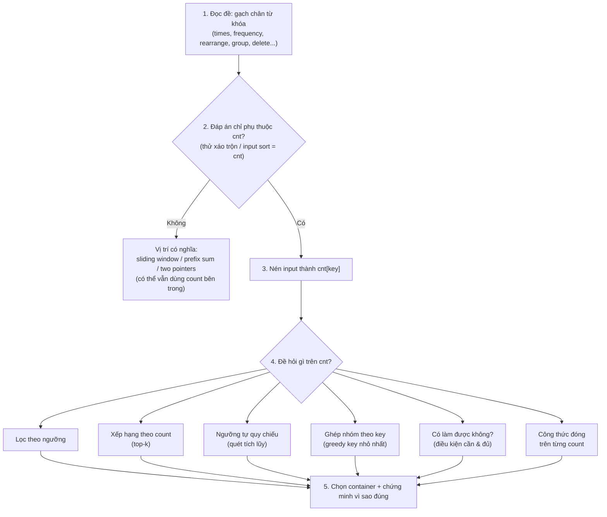

Rất nhiều bài trông có vẻ phải xét từng cặp, từng vị trí ($O(n^2)$), nhưng thực chất đáp án chỉ phụ thuộc vào **mỗi giá trị xuất hiện bao nhiêu lần**. Khi nhận ra điều đó, input được nén thành một vector đếm (histogram), và bài toán chuyển thành một câu hỏi đơn giản hơn nhiều trên vector này.

Bài này tập trung vào **mạch suy nghĩ**: đọc đề → bắt tín hiệu → kiểm chứng → đặt lại câu hỏi trên count → chọn kỹ thuật.

## Câu hỏi gốc (trigger cốt lõi)

> **"Đáp án có chỉ phụ thuộc vào `cnt` không?"**
>
> - **Có** → input thật sự chỉ là vector tần suất → Frequency Map.
> - **Không** → vị trí có nghĩa → xem phần [Khi nào KHÔNG dùng](#khi-nào-không-dùng-phản-ví-dụ).

Cách kiểm tra nhanh: **xáo trộn input, đáp án có đổi không?** Phép thử này chỉ áp dụng được khi đề cho phép input ở mọi thứ tự. Nếu đề ép input vào một **dạng chuẩn** (ví dụ "sorted in non-decreasing order"), hãy hỏi: *dạng chuẩn đó có suy ngược ra được từ `cnt` không?* Mảng đã sort được xác định duy nhất bởi `cnt`, nên vị trí trong đó không chứa thêm thông tin gì: mảng sort chính là `cnt` viết dưới dạng khác (xem 1121).

Mọi dấu hiệu bên dưới đều là các biến thể của câu hỏi này.

## Dấu hiệu nhận biết

- **Chỉ quan tâm "bao nhiêu lần", phớt lờ "ở đâu"**: mục tiêu hoặc điều kiện chỉ dựa trên số lần xuất hiện của phần tử (ví dụ: "phần tử xuất hiện hơn n/k lần", "k phần tử xuất hiện nhiều nhất", "các giá trị xuất hiện đúng 2 lần"). Vị trí và thứ tự ban đầu hoàn toàn không có ý nghĩa.
- **Xóa / sắp xếp tự do**: đề cho phép hoán vị, chia nhóm tùy ý hoặc xóa tùy ý → input thực sự chỉ là một multiset, tức một vector đếm.
- **Miền giá trị hẹp, n lớn**: giá trị chỉ là 26 chữ cái, 10 chữ số, hoặc trong khoảng $[-10^4, 10^4]$ trong khi n tới $10^5$ → chắc chắn có rất nhiều giá trị lặp lại, và có thể đếm bằng mảng thay vì hashmap.
- **Bị giới hạn bởi tần suất cực đại**: tính khả thi hoặc kích thước đáp án bị ghim bởi count lớn nhất, ví dụ $maxFreq \le \lceil n/2 \rceil$ hay $maxFreq \cdot k \le n$ → nghĩ đến nguyên lý chuồng bồ câu.

## Mạch suy luận 5 bước

**Bước 1. Đọc đề, bắt từ khóa.** Các cụm hay gặp:

| Cụm từ trong đề | Gợi ý loại câu hỏi ở bước 4 |
| --- | --- |
| "appears more than n/k times", "exactly twice", "at least x times" | Lọc theo ngưỡng |
| "k most frequent", "sort by frequency" | Xếp hạng theo count |
| "at least h ... at least h times" (h xuất hiện 2 lần) | Ngưỡng tự quy chiếu |
| "rearrange into groups", "consecutive", "groupSize" | Ghép nhóm, greedy theo key |
| "return true if ... can be divided / rearranged" | Điều kiện khả thi |
| "minimum length after operations", "longest palindrome you can build" | Công thức đóng trên từng count |
| "anagram", "permutation of", "same characters" | So sánh hai vector đếm |

**Bước 2. Kiểm chứng bằng phép xáo trộn.** Đừng chỉ tin vào từ khóa. Hãy tự hỏi thử: với input `[3,1,3,2]` và `[1,3,2,3]`, đáp án có giống nhau không? Nếu đề cho mảng *đã sort* thì không xáo trộn được nữa. Khi đó hỏi: mảng sort này có suy ra được từ `cnt` không? Câu trả lời luôn là **có**, nên bài vẫn quy được về `cnt` (1121), và thứ tự sort còn là một **gợi ý** có thể khai thác thêm (1287).

**Bước 3. Nén input.** Chọn key cần đếm (giá trị, ký tự, hay một đặc trưng như số dư `x % k`, chữ ký anagram...). Từ đây, mọi suy luận chỉ dựa trên `cnt`.

**Bước 4. Đặt lại câu hỏi trên `cnt`.** Đây là bước quan trọng nhất: **viết lại đề bằng ngôn ngữ của count**. Ví dụ "chia mảng thành các dãy tăng" trở thành "mỗi bản sao của cùng một giá trị phải nằm ở một dãy khác nhau". Khi viết lại được câu này, thuật toán thường hiện ra ngay.

**Bước 5. Chọn container và lý do đúng.** Xem phần [Các bước triển khai](#các-bước-triển-khai) và [Tại sao đúng](#tại-sao-các-thuật-toán-này-lại-đúng).

## Từ câu chữ đến thuật toán: đi trọn mạch cho từng bài

Mỗi bài được phân tích theo cùng một khung: **Tín hiệu → Kiểm chứng xáo trộn → Viết lại trên count → Thuật toán → Vì sao đúng.**

### 1121. Divide Array Into Increasing Sequences

- **Tín hiệu:** *"return true if this array can be divided into one or more disjoint increasing subsequences of length at least k"*. Đây là câu hỏi khả thi ("can be divided"), và từ "subsequence" cho phép lấy phần tử tùy ý.
- **Kiểm chứng:** *cẩn thận*, nếu mảng **chưa sort** thì xáo trộn **có** làm đổi đáp án. Với `k = 2`: `[1,2]` cho true, nhưng `[2,1]` cho false, vì subsequence phải giữ thứ tự chỉ số. Đáp án chỉ phụ thuộc vào `cnt` là **nhờ ràng buộc "sorted"**: mảng sort được xác định duy nhất bởi `cnt`, và trong mảng sort thì mọi tập giá trị phân biệt đều lấy được thành một subsequence tăng. Ràng buộc thứ tự chỉ số không còn chặn được gì.
- **Viết lại trên count:** "increasing" nghĩa là **hai bản sao của cùng giá trị không thể nằm chung một dãy**. Vậy cần ít nhất `maxFreq` dãy, mỗi dãy dài ít nhất `k` → cần $maxFreq \cdot k \le n$.
- **Thuật toán:** chỉ cần tìm `maxFreq` (mảng đã sort nên đếm độ dài run dài nhất), trả về `maxFreq * k <= n`. Thời gian $O(n)$, bộ nhớ $O(1)$.
- **Vì sao đủ:** chia phần tử thứ i vào dãy `i % maxFreq`. Các giá trị bằng nhau nằm liên tiếp và có tối đa `maxFreq` phần tử, nên không bao giờ rơi chung một dãy; mỗi dãy có ít nhất $\lfloor n / maxFreq \rfloor \ge k$ phần tử.

### 347. Top K Frequent Elements

- **Tín hiệu:** *"return the k most frequent elements"*, kèm follow-up *"better than O(n log n)"*.
- **Kiểm chứng:** xáo trộn mảng không làm đổi "phần tử nào xuất hiện nhiều nhất" → frequency map.
- **Viết lại trên count:** sắp xếp các cặp (key, count) theo count giảm dần và lấy k phần tử đầu.
- **Thuật toán:** sort theo count tốn $O(m \log m)$, không đạt follow-up. Điểm mấu chốt: **count bị chặn trong [1, n]**, nên có thể bucket sort theo count: `bucket[count]` chứa danh sách các key, quét từ n về 1 cho đến khi đủ k phần tử. Thời gian $O(n)$. Cách khác là min-heap kích thước k, tốn $O(n \log k)$.
- **Vì sao đúng:** bucket sort đúng vì miền giá trị của *count* (không phải của *nums*) là [1, n], đủ nhỏ để làm chỉ số mảng.

### 274. H-Index

- **Tín hiệu:** *"maximum value of h such that the researcher has at least h papers that have each been cited at least h times"*. Chữ h xuất hiện **hai lần**: vừa là ngưỡng giá trị, vừa là số lượng. Đây là ngưỡng tự quy chiếu.
- **Kiểm chứng:** thứ tự các bài báo không quan trọng.
- **Viết lại trên count:** gọi `atLeast(h)` là số bài có citation ≥ h. Cần tìm h lớn nhất sao cho `atLeast(h) >= h`.
- **Thuật toán:** h không thể vượt quá n, nên **chặn citation ở n**: `bucket[min(c, n)]++`. Bucket ở đây đánh chỉ số theo *số citation*, không phải theo tần suất. Sau đó quét h từ n xuống 0, cộng dồn `acc += bucket[h]` (acc chính là `atLeast(h)`); h đầu tiên thỏa `acc >= h` là đáp án. Thời gian $O(n)$.
- **Vì sao đúng:** `atLeast(h)` tăng khi h giảm, còn h thì giảm → hai đường cắt nhau đúng một lần. Quét từ trên xuống thì điểm khả thi đầu tiên gặp phải là lớn nhất (tính đơn điệu).

### 846. Hand of Straights

- **Tín hiệu:** *"rearrange the cards into groups so that each group is of size groupSize, and consists of groupSize consecutive cards"*. Có "rearrange" tức là bỏ vị trí.
- **Kiểm chứng:** xáo trộn bộ bài không đổi đáp án → chỉ còn multiset.
- **Viết lại trên count:** xét giá trị nhỏ nhất `x` còn lại. Nó **không thể đứng giữa hoặc cuối** một nhóm (vì không có giá trị nào nhỏ hơn), nên **bắt buộc** mở `cnt[x]` nhóm `x, x+1, ..., x+groupSize-1`.
- **Thuật toán:** kiểm tra `n % groupSize == 0`. Dùng TreeMap (hoặc sort các key), duyệt key tăng dần; với key `x` có `c = cnt[x] > 0`, trừ `c` khỏi `cnt[x..x+groupSize-1]`, nếu có count nào âm thì trả về false. Thời gian $O(n \log n)$.
- **Vì sao đúng:** đây không phải greedy "chọn cái tốt nhất" mà là **không có lựa chọn nào khác**: key nhỏ nhất còn sống bị ép vào vai trò "đầu nhóm".

### 3659. Partition Array Into K-Distinct Groups

- **Tín hiệu:** *"each group contains exactly k elements, all elements in a group are distinct"*. Lại là câu hỏi khả thi về cách chia nhóm.
- **Kiểm chứng:** chia nhóm tùy ý → vị trí vô nghĩa.
- **Viết lại trên count:** số nhóm cố định là `g = n / k`. "distinct" nghĩa là mỗi giá trị xuất hiện tối đa 1 lần trong mỗi nhóm → mỗi count ≤ g.
- **Thuật toán:** trả về `n % k == 0 && maxFreq <= n / k`. Thời gian $O(n)$.
- **Vì sao đủ:** giống 1121: sort rồi xếp phần tử thứ i vào nhóm `i % g`; các bản sao liên tiếp và có tối đa g bản, nên rơi vào các nhóm khác nhau.
- **Liên hệ:** 1121 và 3659 là cùng một khung, *"bản sao của cùng giá trị phải tách ra"* → chuồng bồ câu → điều kiện trên `maxFreq`. Nhận ra khung này là trigger quan trọng nhất của dạng bài khả thi.

### 3223. Minimum Length of String After Operations

- **Tín hiệu:** *"choose an index i such that there is at least one character to the left equal to s[i], and at least one to the right... delete the closest occurrence to the left and to the right"*. Đề nói nhiều về trái/phải, rất dễ bị đánh lừa là vị trí quan trọng.
- **Kiểm chứng:** mỗi thao tác chỉ đụng đến các bản sao **của cùng một ký tự**, và chỉ yêu cầu "có bản sao ở hai bên". Các ký tự khác nhau không tương tác với nhau → mỗi ký tự là một bài toán độc lập trên count của nó.
- **Viết lại trên count:** với ký tự có count `c ≥ 3`, luôn có một bản sao nằm giữa → giảm `c` đi 2. Lặp lại đến khi `c ∈ {1, 2}`.
- **Thuật toán:** cộng 1 nếu c lẻ, 2 nếu c chẵn **và c > 0**. Ký tự không xuất hiện đóng góp 0 (bẫy count = 0).
- **Vì sao đúng:** mỗi thao tác giữ nguyên tính chẵn/lẻ của c (bất biến), và luôn thực hiện được khi c ≥ 3.

### 767. Reorganize String

- **Tín hiệu:** *"rearrange the characters so that any two adjacent characters are not the same"*.
- **Kiểm chứng:** "rearrange" → multiset.
- **Viết lại trên count:** ký tự nhiều nhất cần được ngăn cách bởi các ký tự khác → cần $maxFreq \le \lceil n/2 \rceil$, tức `maxFreq <= (n + 1) / 2`.
- **Thuật toán:** nếu thỏa, điền ký tự nhiều nhất vào các vị trí chẵn 0, 2, 4…, sau đó điền các ký tự còn lại tiếp tục vào chỗ chẵn rồi sang chỗ lẻ.

### 1338. Reduce Array Size to The Half

- **Tín hiệu:** *"choose a set of integers and remove all the occurrences... at least half of the integers are removed"*. "Remove all occurrences" nghĩa là mỗi lựa chọn có giá trị bằng đúng count của nó.
- **Viết lại trên count:** chọn ít count nhất sao cho tổng ≥ n/2 (nhân chéo: `removed * 2 >= n`).
- **Thuật toán:** sort count giảm dần (hoặc bucket theo count), lấy dần. Đúng nhờ exchange argument.

### 1287. Element Appearing More Than 25% In Sorted Array

- **Tín hiệu:** *"sorted"* và *"more than 25%"*.
- **Bước 2 bắt được bẫy:** mảng đã sort là gợi ý có thể khai thác, nên không cần hashmap. Một run dài hơn n/4 buộc phải phủ một trong các vị trí $n/4, n/2, 3n/4$; hoặc đơn giản là kiểm tra `arr[i] == arr[i + n/4]`. Bộ nhớ $O(1)$.

## Khi nào KHÔNG dùng (phản ví dụ)

Biết ranh giới thì trigger mới chính xác. Nếu bước 2 trả lời **"có đổi"**, frequency map không còn là toàn bộ lời giải:

| Đề bài | Vì sao vị trí quan trọng | Hướng đúng |
| --- | --- | --- |
| 560. Subarray Sum Equals K | "subarray" = liên tiếp | Prefix sum + hashmap đếm **prefix**, không đếm phần tử |
| 438. Find All Anagrams in a String | "substring" liên tiếp, nhưng **bên trong cửa sổ** thì thứ tự vô nghĩa | Sliding window + vector đếm (dạng lai) |
| 2653. Sliding Subarray Beauty | cửa sổ liên tiếp, nhưng giá trị ∈ [-50, 50] | Sliding window + mảng đếm 101 ô |
| 387. First Unique Character | "first" là thông tin vị trí | Đếm xong, **quét lại theo vị trí** (dạng lai) |

Bài học: *"bất biến hoán vị"* có thể chỉ đúng **cục bộ** (trong một cửa sổ, một nhóm). Khi đó vẫn dùng vector đếm, nhưng cập nhật nó theo cửa sổ.

## Các bước triển khai

- **B1: Chọn key để đếm.** Giá trị, ký tự, `x % k`, chữ ký anagram (sorted string hoặc mảng 26 ô)...
- **B2: Chọn container** theo **miền giá trị của key** (không phải theo n):
    - Miền nhỏ (≲ $10^5$, ví dụ 26 chữ cái, $[-10^4, 10^4]$) → `int[]`, cộng offset nếu có số âm.
    - Miền lớn (đến $10^9$) → `HashMap`.
    - Cần duyệt theo thứ tự key → `TreeMap` (hoặc đếm bằng HashMap rồi sort các key).
- **B3: Quét tuyến tính một lần**, đồng thời duy trì các biến cần thiết: maxFreq, argmax, số key phân biệt...
- **B4: Xử lý trên tập key phân biệt** (phần cốt lõi của thuật toán):
    - **Lọc theo ngưỡng:** `count * k > n` (luôn nhân chéo, tránh số thực), `count == 2`, `isPrime(count)`.
    - **Xếp hạng theo count:** sort các cặp (key, count); bucket sort theo count để đạt $O(n)$; min-heap kích thước k cho bài top-k.
    - **Quét tích lũy:** quét giảm dần trên trục giá trị, cộng dồn suffix count.
    - **Greedy theo key:** duyệt key đã sort, key nhỏ nhất còn sống bị ép vào một vai trò cố định; dùng nó rồi trừ count tương ứng.
    - **Điều kiện khả thi:** thường có dạng ràng buộc trên `maxFreq` (chuồng bồ câu).
    - **Công thức đóng:** palindrome dài nhất $2 \cdot \sum \lfloor f/2 \rfloor + [\text{có } f \text{ lẻ}]$; số cặp khác giá trị $\frac{1}{2}\sum c \cdot (N-c)$ (chia 2 **sau khi** cộng tổng), hoặc tương đương $\binom{N}{2} - \sum \binom{c}{2}$.

## Tại sao các thuật toán này lại đúng?

Đằng sau các bước xử lý count luôn có những nền tảng toán học:

- **Bất biến hoán vị:** việc đếm làm mất thông tin vị trí, nhưng nếu bài toán không quan tâm vị trí thì hai mảng có cùng vector tần suất là như nhau. Loay hoay viết hai vòng lặp $O(n^2)$ chỉ là cố tìm lại thông tin mà histogram đã phơi bày.
- **Nguyên lý Dirichlet (chuồng bồ câu):** giải thích các điều kiện khả thi như $maxFreq \cdot k \le n$ (1121), $maxFreq \le n/k$ (3659) hay $maxFreq \le \lceil n/2 \rceil$ (767).
- **Exchange argument (lập luận hoán đổi):** giải thích vì sao greedy đúng. Đổi một phần tử đã chọn lấy một phần tử chưa chọn có count cao hơn không bao giờ làm kết quả tệ đi → ưu tiên count lớn nhất trước là tối ưu (1338).
- **Bị ép buộc (forced choice):** key nhỏ nhất còn lại chỉ có đúng một vai trò hợp lệ, nên greedy không phải là "đoán" (846).
- **Tính đơn điệu (monotonicity):** số item thỏa ngưỡng chỉ tăng khi ngưỡng hạ xuống, nên ngưỡng khả thi đầu tiên gặp khi quét từ trên xuống chính là đáp án lớn nhất (274).
- **Bất biến chẵn/lẻ:** thao tác luôn xóa 2 bản sao thì parity của count không đổi (3223).

## Những cái bẫy thường gặp (Pitfalls)

- **Tràn số nằm ở histogram:** đếm cặp $c \cdot (N-c)$ hoặc tính tổng $\sum i \cdot count[i]$ (1093) với count lớn rất dễ vượt 32-bit. Luôn dùng `long`.
- **Không so sánh ngưỡng bằng số thực:** nhân chéo, dùng `count * 4 > n` thay vì `count / n > 0.25`.
- **Bỏ quên count = 0:** "tần suất chẵn" cũng đúng với các chữ cái không xuất hiện; "tần suất nhỏ nhất" sẽ bằng 0 với giá trị không có mặt. Hãy ghi rõ điều kiện `count > 0` (xem 3223).
- **Tie-break:** thường được giải quyết miễn phí nếu duyệt key **theo thứ tự** kèm so sánh ngặt (`<` thay vì `<=`). Đừng dựa vào thứ tự duyệt `HashMap`, vì thứ tự đó **không được đảm bảo theo key**.
- **Sửa count của entry đang nằm trong heap:** heap không tự sắp xếp lại khi bạn sửa count. Cách xử lý: remove rồi insert lại, hoặc lazy deletion (push cặp `(key, count)` mới và bỏ qua cặp cũ khi pop ra nếu count không khớp).
- **Đề cho mảng đã sort, đừng vứt gợi ý đó:** tìm phần tử chiếm > 25% trên mảng đã sort chỉ cần xét các mốc $n/4, n/2, 3n/4$ (1287). Dùng hashmap là bỏ phí lợi thế này.

## Checklist ôn nhanh

1. Đáp án có chỉ phụ thuộc vào `cnt` không? (thử xáo trộn; nếu input đã sort thì nó chính là `cnt`)
2. Viết lại đề bằng một câu chỉ chứa "count".
3. Câu đó thuộc loại nào: ngưỡng / xếp hạng / tự quy chiếu / ghép nhóm / khả thi / công thức?
4. Chọn container theo miền giá trị của key, không theo n.
5. Kiểm tra lại: count = 0, tràn số, số thực, tie-break.

## References

- Nhóm: Đếm & Hashing. Tên gọi khác: Counting map, Top-K frequent, Bucket by count.
- Bài tập: 274, 347, 387, 438, 560, 767, 846, 1093, 1121, 1287, 1338, 2653, 3223, 3583, 3659.
