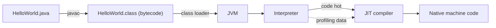
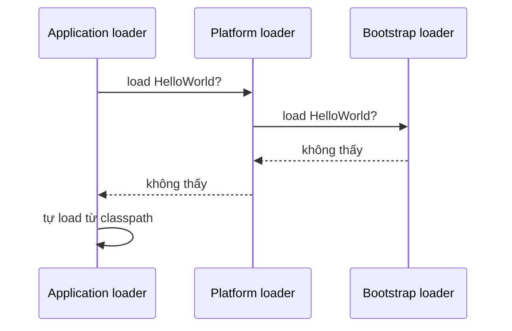
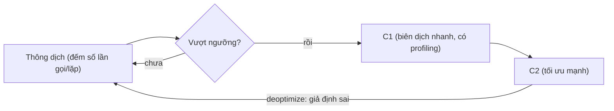

## Cách JVM chạy code 
- Đa số lập trình viên chạy `java myApp` hàng ngày mà không cần suy nghĩ điều gì xảy ra tiếp theo. Điều này là bình thường, java được thiết kế để làm điều đó, bạn không cần suy nghĩ về nó. Nhưng nếu bạn muốn hiểu tại sao code chạy nhanh, chậm, thì bạn cần biết chính xác cách mà JVM thực thi code
- Bài viết này xây dựng 5 bước: **source -> bytecode -> classloading -> interpreter -> JIT**. Cuối cùng, chúng ta sẽ đi đến kết luận: *Code mà chạy không phải code mà bạn viết*



## 1. javac chuyển code thành bytecode

Bắt đầu với 1 chương trình đơn giản 

```java
public class HelloWorld {
    public static void main(String[] args) {
        for (int i = 0; i < 10; i++) {
            System.out.println("Hello World");
        }
    }
}
```

- Khi bạn chạy javac chuyển file thành `HelloWorld.class`. File này không chứa mã máy, nó chứa **bytecode**: hướng dẫn cho JVM thực thi 

- Hai sự thật về bytecode: 
    - **javac tối ưu rất ít**: nó dịch code trực tiếp, bytecode rất đơn giản và đọc được. Phần tối ưu sẽ để chạy sau, khi runtime
    - **Bytecode độc lập với mã máy**: same file `.class` có thể chạy với linux, macos, windows, x86 hoặc arm. Nó là đặc tính "write once, run anywhere"

### Có gì trong file class 

| Phần | Nó chứa gì |
|---|---|
| Magic number | Luôn là `0xCAFEBABE` — đánh dấu đây là một class file |
| Version | Phiên bản minor và major của định dạng class file |
| Constant pool | Các hằng số: tên class, tên method, string, số |
| Access flags | `public`, `abstract`, `final`, v.v. |
| This class / superclass | Đây là class nào, và cha của nó là class nào |
| Interfaces | Các interface mà class implements |
| Fields | Các field của class |
| Methods | Các method, bao gồm cả bytecode của chúng |
| Attributes | Dữ liệu bổ sung, ví dụ tên file source |

### Xem bytecode thật

Chạy `javap -c HelloWorld` để xem bytecode của `main`:

```
public static void main(java.lang.String[]);
  Code:
     0: iconst_0
     1: istore_1                 // int i = 0
     2: iload_1
     3: bipush        10
     5: if_icmpge     22         // i < 10 ? nếu không, nhảy tới 22
     8: getstatic     #2         // Field java/lang/System.out
    11: ldc           #3         // String Hello World
    13: invokevirtual #4         // Method java/io/PrintStream.println
    16: iinc          1, 1       // i++
    19: goto          2          // quay lại đầu vòng lặp
    22: return
```

javac dịch gần như từng dòng một ("dumb bytecode"): không unroll vòng lặp, không tối ưu gì cả. Các opcode như `iconst_0`, `iload_1`, `goto` sẽ gặp lại ở phần interpreter.

## 2. Class loader mang class vào JVM 
- Khi bạn gõ `java HelloWorld`, hệ điều hành bắt đầu chạy JVM. Trước khi bytecode có thể chạy, class phải được **load**, nó thực thi bởi chuỗi sau: 

1. **Bootstrap class loader**: loads các core class như `java.lang.Object`, `Class`, và `ClassLoader` và `java.base` module, nó là 1 phần của JVM 
2. **Platform class loader** - load các platform modules. Cha của nó là các bootstrap loader 
3. **Application class loader** - load class của bạn từ classpath. Cha của nó là platform loader 

- Có 3 luật mà cách loading hoạt động 
    - **Lazy**: Một class được load trong lần đầu nó được sử dụng chứ không phải lúc khởi động 
    - **Delegation**: Một loader đầu tiên yêu cầu cha của nó load class. Chỉ khi cha không tìm thấy, loader mới tự load. Nếu không loader nào trong chuỗi tìm được class, bạn sẽ gặp `ClassNotFoundException`
    - **Identity includes the loader**: Nếu hai class loader khác nhau load cùng 1 class với chung tên, JVM vẫn coi đó là hai class khác nhau. 



- Hai điều chi tiết khác
    - Bootstrap loader **không verify** class mà nó load, để startup nhanh hơn: nó dựa vào việc boot classpath là an toàn. Đó là lý do danh sách các class nó load được giữ ở mức nhỏ. Mọi class khác đều được verify trước khi chạy.
    - Từ Java 9, mọi JVM sẽ dùng **modular**. Lúc khởi động, JVM luôn dựng module graph. Graph không được có cycle, nếu có cycle thì sẽ bị lỗi và JVM sẽ không chạy nữa. 

## 3. Interpreter chạy code 
- Khi mà `Hello World` được tải lên JVM, hàm `main()` được thực thi, nó bắt đầu **interpreter**. 
- Cuốn sách đưa ra một mô hình tư duy đơn giản: trình thông dịch JVM chính là **"một cấu trúc switch nằm bên trong một vòng lặp while."**

```java
while (true) {
    int opcode = code[pc++];
    switch (opcode) {
        case ICONST_0: stack.push(0); break;
        case ILOAD_1:  stack.push(locals[1]); break;
        case GOTO:     pc = readTarget(); break;
        // ... one case per opcode
    }
}
```

- the interpreter sẽ đọc opcode, và xử lý từng opcode 
- Hotspot interpreter sẽ phức tạp hơn, nhưng model thì tương tự. Và nó chỉ ra 1 vấn đề: thông dịch sẽ chậm. Mọi tập lệnh sẽ chạy qua 1 vòng lặp, một CPU chạy native code sẽ nhanh hơn cho cùng 1 công việc 

Vậy sao để java chạy nhanh? 

## 4. Hotspot và JIT 

Ý tưởng: 

- 1. Toàn bộ code bắt đầu với thông dịch 
- 2. Trong khi thông dịch, JVM thu thập **profiling data**: Cái nào call thường xuyên, cái nào chạy nhiều lần, nhánh nào được lấy, loại nào hay xuất hiện ...
- 3. Khi một hàm hoặc loop trở nên "hot" -vượt qua 1 ngưỡng, hotspot sẽ chuyển nó thành **native machine code** 
- 4. Từ lúc đó, native code sẽ chạy thay vì bản thông dịch. Một số trình biên dịch thậm chí có thể biên dịch lại nó sau đó với thông tin tốt hơn.



Đó là lý do mà nó gọi là "HotSpot": nó tìm các hot spots trong chương trình và dành năng lực tối ưu chỉ trong đoạn code đó 

- **Tiered compilation**: HotSpot có hai JIT: C1 biên dịch nhanh nhưng tối ưu ít; C2 chậm hơn nhưng tối ưu mạnh. Hàm hot thường đi qua C1 trước rồi mới lên C2, đó chính là "biên dịch lại với thông tin tốt hơn" ở bước 4.
- **OSR (on-stack replacement)**: `main()` của HelloWorld chỉ được gọi một lần nhưng có vòng lặp. JIT vẫn có thể biên dịch vòng lặp đó và chuyển sang bản native ngay giữa lúc vòng lặp đang chạy, kỹ thuật này gọi là on-stack replacement (OSR).

### Tại sao biên dịch runtime có thể đánh bại biên dịch tĩnh 

- Trình biên dịch c++ biên dịch mọi thứ AOT, nó phải đoán cách mà chương trình chạy 
- JIT thì không đoán, nó thấy được cách mà chương trình chạy, cách mà chương trình hoạt động. Nó cho phép những tối ưu mà AOT không thể làm 
    - **Inlining dựa trên lời gọi thực tế**: Nếu profiling chỉ ra phía gọi luôn gọi cùng một phương thức, thì JIT có thể copy hàm đó vào trong caller 
    - **Devirtualization** : Nếu một phương thức giao diện trên thực tế chỉ có duy nhất một cách triển khai, trình biên dịch JIT có thể chuyển đổi lời gọi ảo (virtual call) thành lời gọi trực tiếp (direct call).
    - **CPU-specific code.** HotSpot phát hiện chính xác các tính năng của CPU khi khởi động và có thể sử dụng các tập lệnh đặc biệt (kỹ thuật phát hiện chính xác khả năng của bộ xử lý này trong sách gọi là "JVM intrinsics", đừng nhầm với intrinsic lock của `synchronized`).
- **Deoptimization**: các tối ưu dựa trên profiling chỉ là những "giả định". Nếu giả định sai (ví dụ một implementation thứ hai của interface được load), JVM bỏ bản native và quay về thông dịch, rồi có thể biên dịch lại sau đó.
- Ngoài ra còn có một lợi ích tích cực khác: HotSpot là thành quả của hàng trăm năm công kỹ thuật (engineering years). Khi bạn nâng cấp JVM, ứng dụng của bạn sẽ nhận được các tối ưu hóa mới **mà không cần biên dịch lại bất cứ thứ gì**.

> Mã được biên dịch theo cơ chế JIT (JIT-compiled code) khi thực thi trên JVM có thể hoàn toàn khác biệt so với mã nguồn Java ban đầu.

- Hàm được inlined vào 1 hàm khác. Lời gọi ảo trở thành lời gọi trực tiếp, code không chạy có thể bị loại bỏ. Machine code sẽ định hình cách mà chương trình của bạn chạy, chứ không phải dựa trên những gì bạn viết 

## Vậy ta có được gì
- 1. Đừng tin những cảm nhận chung về hiệu năng. Suy nghĩ kiểu "dòng này có vẻ chậm" thường sai vì nó không phải là dòng code sẽ được chạy bởi JIT. 
- 2. Microbenchmarks là khó: đo một đoạn code nhỏ rất khó vì JIT có thể tối ưu nó theo cách không xảy ra trong ứng dụng thật (ví dụ loại bỏ code mà kết quả không được dùng). Sách nói phần lớn lập trình viên không nên tự làm việc này. 
- 3. **Measure the real application.** Performance là một thuộc tính của hệ thống đang chạy, chứ không phải source code 

## References

- Benjamin J. Evans, James Gough — *Optimizing Cloud Native Java, 2nd Edition* (O'Reilly), Chương 3 "Overview of the JVM" và Chương 6 "Code Execution on the JVM".
