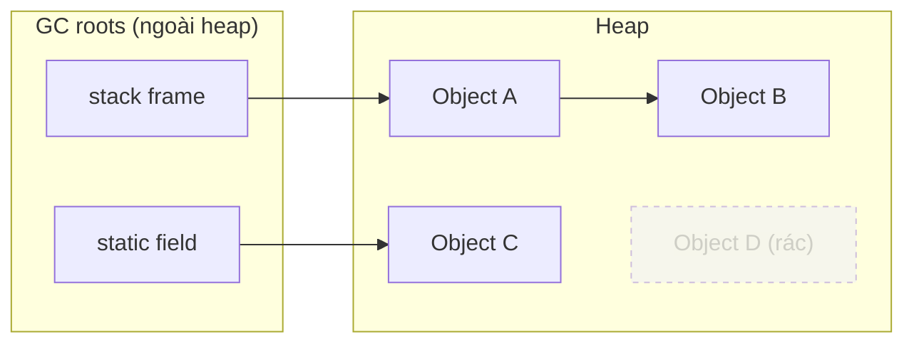
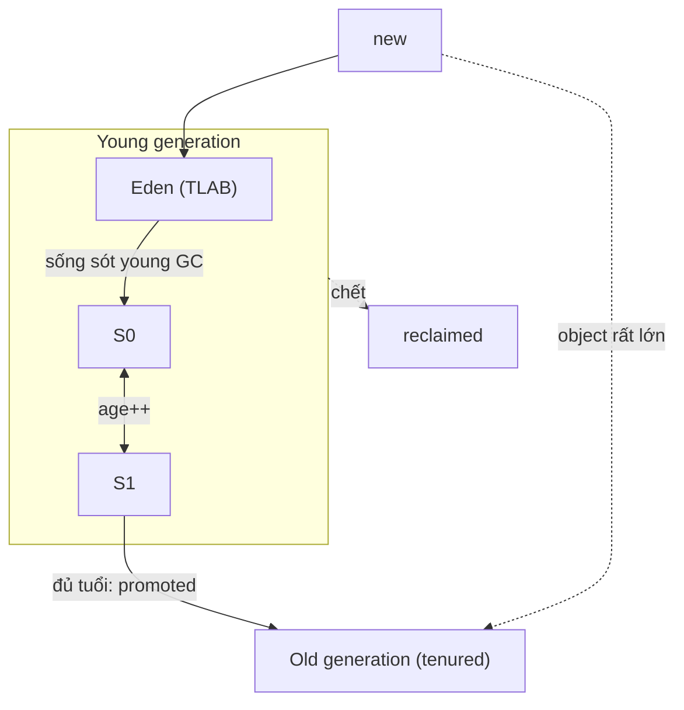
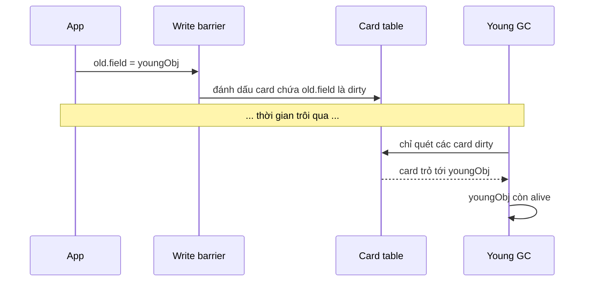

Ghi chú chương 4 của *Optimizing Cloud Native Java*: object được biểu diễn thế nào trong Hotspot, GC roots, heap chia theo generation, TLAB và card table.

## Dữ liệu trong Java: primitive và reference
- Java có hai kiểu dữ liệu:
    - **primitives**: `int`, `long`, `double`, `boolean`, ...
    - **object references**: con trỏ trỏ đến object trên heap
- Không giống C, bạn không lấy được địa chỉ của biến hay làm phép toán con trỏ. Chỉ có thể dùng `.` để gọi method hoặc truy cập field
- Java luôn **pass-by-value**: method nhận một bản copy của reference, trỏ đến cùng object trên heap. Object không bị copy, nên method có thể thay đổi object bạn truyền vào

## Object nhìn như nào trong Hotspot
- Trong Hotspot, một Java object được biểu diễn bằng **oop** (*ordinary object pointer*): một C++ pointer trỏ vào Java heap. Có nhiều loại: `instanceOop` cho object thường, `arrayOop` cho array
- Mọi object trên heap bắt đầu bằng **header** gồm 2 machine word:
    - **Mark word**: thông tin theo từng trường hợp, như identity hash code và trạng thái lock
    - **Klass word**: pointer đến metadata của class
- Array có thêm trường **length** (int 32-bit). Nhờ đó Java biết độ dài array, và độ dài tối đa xấp xỉ `Integer.MAX_VALUE`

```
object: | mark word | klass word | fields...                     |
array:  | mark word | klass word | length (32-bit) | elements... |
```

## Compressed oops
- Trên JVM 64-bit mỗi reference tốn 8 byte. **Compressed oops** nén reference xuống 32-bit, Hotspot bật mặc định
- Một số hướng dẫn tuning cũ cho hệ thống low-latency khuyên tắt compressed oops, làm heap phình thêm khoảng 10-50%. Đây là ví dụ của antipattern **Fiddling with Switches**: đổi JVM flag mà không có lý do chính đáng. Default tồn tại là có lý do

## GC roots
- Trước khi xem heap layout cần hiểu **GC root**: một pointer đứng **bên ngoài** heap và trỏ vào **trong** heap. Ví dụ:
    - local variable trong stack frame
    - reference do native code giữ
    - CPU register
    - static/global data
    - class metadata
- Object **alive** nếu từ GC root có thể đi đến nó qua chuỗi reference. Còn lại đều là rác



## Hai con số điều khiển tất cả
- **Allocation rate**: ứng dụng cấp phát bao nhiêu bộ nhớ mỗi giây (vd 100MB/s). Tool như JDK Flight Recorder ước lượng được
- **Object lifetime**: object tồn tại bao lâu. Khó đo hơn nhưng nền tảng hơn

## Giả thuyết weak generational
- Đo lifetime của object, bạn sẽ thấy:
    - Đa số object chết trẻ: `String` tạm, iterator, request object chỉ sống vài ms
    - Một nhóm nhỏ sống lâu: cache, configuration, connection pool, object của ứng dụng
- Rất ít object nằm giữa hai nhóm

```
số object
 │ ██
 │ ██ ██
 │ ██ ██ ▄▄                      ▄▄
 │ ██ ██ ██ ▂▂                ██ ██
 └──────────────────────────────────── tuổi (age)
   trẻ (request, String tạm)    già (cache/config/pool)
```

- Đây là giả thuyết **weak generational**. Nó không phải định luật, chỉ là quan sát về cách phần mềm hoạt động, nhưng là ý tưởng nền của Hotspot heap
- Nhờ đó heap tách young và old object thành hai vùng và dọn độc lập:
    - Young area đầy nhanh nhưng gần như mọi thứ đã chết, nên dọn nhanh và rẻ
    - Old area thay đổi chậm, không cần xem thường xuyên
- Hệ quả: với young GC (copying), collector chỉ chạm live object, dọn object chết không tốn chi phí. Nếu 98% young object chết, chỉ làm việc với 2% còn sống

## Nơi object sinh ra: Eden và TLAB
- Object mới được tạo trong vùng **Eden**
- Nếu mọi thread cùng tranh Eden thì phải lock để tránh race, gây chậm. Hotspot chia Eden thành các **TLAB** (thread-local allocation buffer), mỗi thread có một buffer riêng
- Cấp phát trong TLAB rất nhanh: thread chỉ giữ pointer đến vùng trống tiếp theo, tạo object chỉ cần đẩy pointer lên phía trước

```
TLAB:  [obj][obj][obj][ free space ............ ]
                      ^
                      next free byte  →  move forward by object size
```

- Kỹ thuật này gọi là **pointer bumping**: O(1), không cần lock; ở mức C code chỉ là thêm một instruction tăng pointer
- Hotspot còn resize TLAB động: thread cấp phát nhiều sẽ nhận buffer lớn hơn
- TLAB đầy thì thread được cấp TLAB mới. Khi **Eden hết TLAB**, đến lúc chạy young GC
- Lưu ý từ sách: TLAB chỉ private lúc cấp phát. Khi bạn đưa object sang thread khác (vd qua lambda chạy trên thread pool), nó thành object dùng chung như mọi object khác. TLAB làm cấp phát nhanh hơn, không làm GC dễ hơn

## Cấu trúc heap cổ điển trong Hotspot
Mỗi object có một giá trị **age**: số lần GC nó đã sống sót.

1. Object mới được cấp phát trong **Eden** (trong TLAB)
2. Sống sót qua young GC, nó được copy sang **survivor space** và age tăng
3. Mỗi lần young GC, survivor được copy qua lại giữa S0 và S1
4. Đủ tuổi thì được **promoted** vào **old generation** (còn gọi là *tenured*)



- Object rất lớn có thể bỏ qua các bước trên, cấp phát thẳng vào old generation
- Khi khởi động, JVM cấp phát (hoặc reserve) toàn bộ heap từ hệ điều hành, rồi tự quản lý, không cần xin OS cho từng object

### Card table: old object trỏ đến young object
- Vấn đề: young GC chỉ muốn xét young generation. Nhưng nếu một object **old** giữ reference đến object **young** thì object young đó vẫn alive. Muốn biết phải quét cả old generation, rất đắt
- Hotspot giải quyết bằng **card table**: một mảng byte, mỗi byte (một *card*) đại diện cho 512 byte của old generation. Mỗi khi chương trình ghi reference vào field của object old, một đoạn code nhỏ gọi là **write barrier** đánh dấu card tương ứng là "dirty":

```c
cards[*oop >> 9] = 0; // 2^9 = 512 byte mỗi card
```

- Khi young GC, collector chỉ quét các card dirty thay vì cả old generation



- Collector hiện đại dùng phiên bản nâng cao hơn gọi là **remembered sets**. Một số collector như G1 còn chia heap thành các region thay vì generation cố định, sẽ nói ở chương 5 của sách
